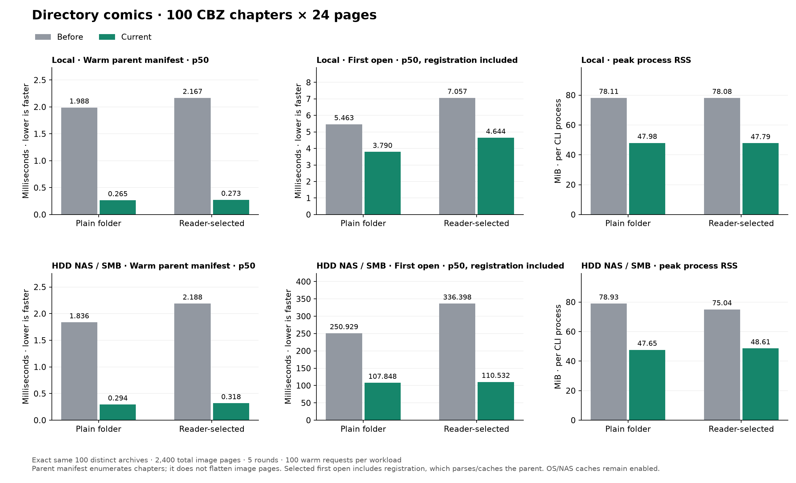

# Directory comics: 100 CBZ chapters — 2026-10-29

This extends the existing [optimization results](optimization-2026-10-29.md)
with a directory-of-CBZ publication. **No production serving/cache code was
changed for this test.** It uses the exact saved before/after executables:

- Before: CLI `d123c32580915b722464f3a9c5dd8eb42a68e0ee`, toolkit `c070049715c50c756fc29f8349c6af96324e266d`.
- After: CLI `989c2f1b3d01cc2fc06ba697373e2887f0993ca8`, toolkit `99d1e931c3a60131ed36de4448c17312cc2826ca`.



[Interactive directory comparison](directory-comics-2026-10-29/directory-comparison.html)
includes all parent/chapter workloads and first-byte/complete p50/p95 controls.

## Fixture, protocol and identity checks

`Series/` contains **100 distinct CBZ files, 24 pages each (2,400 pages total)**,
named `Chapter 001.cbz` through `Chapter 100.cbz`. Each contains a unique
ComicInfo.xml and valid 256×384 PNG pages. Total archive size is 34,540,298 bytes.
All file SHA-256s match between local storage, NAS and both executable runs.
The complete normalized parent manifest matches, not just its chapter count.

The parent manifest enumerates CBZ chapter resources. It is **not a flattened
2,400-page manifest**. Both plain and selected variants return exactly 100
reading-order links, 100 TOC links and 100 positions, in chapter order. The test
also verifies full archive hashes and prefix-range bytes for chapters 1/50/100,
and opens chapter 50 separately to verify its 24 pages and dimensions.

Two cases run in separate fresh CLI processes:

- **Plain folder:** direct manifest request for `Series`.
- **Reader-style selection:** register all 100 ordered HREFs with the private
  directory-selection v1 API, then open the parent using the opaque handle.
  The returned acknowledgement/digest is checked. Both cases must expose the
  same full parent manifest; no chapters or metadata are removed for speed.

**Registration itself opens and caches the selected publication.** Consequently,
its first GET and first eight-client GET burst are cache hits, not cold parsing.
The correct selected first-open comparison is **registration + first GET**;
registration and GET are also reported separately. CLI startup is excluded.

The saved fixtures remain at `/tmp/readium-perf/directory-comics` locally and
`/mnt/Media/Reader_Testing/directory-comics` on the HDD-backed SMB share. SHA-256
lists are retained as `fixtures.sha256`, outside `Series` so they cannot alter
the directory publication. Metadata/run order is in `metadata.json`.

## HTTP results

Pooled nearest-rank **p50 / p95 milliseconds**, full-body completion. Five rounds,
100 requests per warm workload per round, concurrency eight where indicated,
Go 1.26.0, GOMAXPROCS=4, GOMEMLIMIT unset, identity encoding, debug mode on.
First opens/revisits have only five samples, bursts 40, warm rows 500, and
chapter-pressure opens 60. All suites ran sequentially, before then after on
local storage, then before/after on NAS. These are application-cache tests;
OS and NAS caches are not flushed and source hashing warms filesystem data.
Reader proxy/DB, remote user network and image rendering are excluded.

For cache pressure the test opens twelve existing chapter publications, then
revisits the parent: this models chapter navigation without copying the whole
series twelve times. Cache capacity stays ten. Hit/admission behavior is policy-
dependent, so revisits are not assumed to miss. Cold single-source timing on
NAS is variable, and differences include cache/history effects; these five-
sample rows do not isolate a particular optimization or physical HDD speed.

### local · plain

| Workload | Before p50 / p95 | Current p50 / p95 | Median speedup |
| --- | ---: | ---: | ---: |
| First parent GET (cold only in plain mode) | 5.463 / 9.456 | 3.790 / 4.888 | 1.44× |
| Eight-client first GET burst (post-registration for selected) | 14.470 / 17.873 | 4.418 / 6.914 | 3.28× |
| Warm parent manifest | 1.988 / 2.849 | 0.265 / 0.443 | 7.50× |
| Warm parent manifest, concurrency 8 | 7.264 / 14.190 | 0.234 / 1.056 | 31.08× |
| Parent positions | 2.103 / 3.273 | 0.724 / 1.343 | 2.90× |
| Full middle CBZ through parent | 1.532 / 2.439 | 0.403 / 0.662 | 3.80× |
| Full middle CBZ through parent, concurrency 8 | 6.148 / 11.883 | 0.402 / 1.379 | 15.28× |
| Middle CBZ prefix range | 1.671 / 2.651 | 0.321 / 0.494 | 5.21× |
| Individual 24-page chapter manifest | 1.670 / 2.607 | 0.249 / 0.335 | 6.72× |
| Open twelve individual chapter publications | 2.705 / 3.814 | 0.914 / 1.589 | 2.96× |
| Revisit parent after twelve chapter opens | 2.480 / 3.288 | 0.280 / 0.596 | 8.86× |

### local · selected

| Workload | Before p50 / p95 | Current p50 / p95 | Median speedup |
| --- | ---: | ---: | ---: |
| Registration (opens/caches selected publication) | 4.365 / 4.582 | 3.749 / 5.075 | 1.16× |
| Selected first open: registration + first GET | 7.057 / 8.175 | 4.644 / 6.045 | 1.52× |
| First parent GET (cold only in plain mode) | 2.568 / 3.741 | 0.964 / 2.014 | 2.66× |
| Eight-client first GET burst (post-registration for selected) | 8.721 / 10.619 | 1.072 / 1.297 | 8.13× |
| Warm parent manifest | 2.167 / 3.270 | 0.273 / 0.387 | 7.95× |
| Warm parent manifest, concurrency 8 | 7.258 / 13.476 | 0.227 / 0.610 | 32.04× |
| Parent positions | 2.118 / 3.258 | 0.762 / 1.383 | 2.78× |
| Full middle CBZ through parent | 1.652 / 2.655 | 0.416 / 0.705 | 3.97× |
| Full middle CBZ through parent, concurrency 8 | 6.115 / 11.742 | 0.443 / 1.373 | 13.82× |
| Middle CBZ prefix range | 1.722 / 2.618 | 0.343 / 0.580 | 5.02× |
| Individual 24-page chapter manifest | 1.787 / 2.748 | 0.259 / 0.392 | 6.89× |
| Open twelve individual chapter publications | 2.551 / 3.359 | 1.031 / 1.842 | 2.47× |
| Revisit parent after twelve chapter opens | 2.125 / 3.321 | 0.399 / 0.580 | 5.33× |

### nas · plain

| Workload | Before p50 / p95 | Current p50 / p95 | Median speedup |
| --- | ---: | ---: | ---: |
| First parent GET (cold only in plain mode) | 250.929 / 280.835 | 107.848 / 120.708 | 2.33× |
| Eight-client first GET burst (post-registration for selected) | 703.011 / 780.918 | 101.088 / 138.816 | 6.95× |
| Warm parent manifest | 1.836 / 2.501 | 0.294 / 0.443 | 6.25× |
| Warm parent manifest, concurrency 8 | 6.998 / 12.490 | 0.219 / 0.549 | 32.00× |
| Parent positions | 1.983 / 2.979 | 0.811 / 1.546 | 2.45× |
| Full middle CBZ through parent | 1.516 / 2.327 | 0.438 / 0.821 | 3.46× |
| Full middle CBZ through parent, concurrency 8 | 5.929 / 11.076 | 0.498 / 1.605 | 11.91× |
| Middle CBZ prefix range | 1.572 / 2.435 | 0.392 / 0.771 | 4.01× |
| Individual 24-page chapter manifest | 1.738 / 2.716 | 0.292 / 0.430 | 5.95× |
| Open twelve individual chapter publications | 12.511 / 27.540 | 1.462 / 2.732 | 8.55× |
| Revisit parent after twelve chapter opens | 2.966 / 4.401 | 0.389 / 0.634 | 7.62× |

### nas · selected

| Workload | Before p50 / p95 | Current p50 / p95 | Median speedup |
| --- | ---: | ---: | ---: |
| Registration (opens/caches selected publication) | 333.197 / 460.764 | 108.955 / 117.909 | 3.06× |
| Selected first open: registration + first GET | 336.398 / 465.695 | 110.532 / 118.994 | 3.04× |
| First parent GET (cold only in plain mode) | 3.155 / 4.828 | 1.121 / 2.599 | 2.81× |
| Eight-client first GET burst (post-registration for selected) | 8.642 / 10.823 | 1.344 / 1.964 | 6.43× |
| Warm parent manifest | 2.188 / 4.505 | 0.318 / 0.546 | 6.87× |
| Warm parent manifest, concurrency 8 | 8.197 / 23.027 | 0.258 / 0.680 | 31.76× |
| Parent positions | 2.331 / 3.823 | 1.040 / 2.179 | 2.24× |
| Full middle CBZ through parent | 2.063 / 3.213 | 0.510 / 0.938 | 4.04× |
| Full middle CBZ through parent, concurrency 8 | 6.702 / 12.940 | 0.585 / 1.839 | 11.46× |
| Middle CBZ prefix range | 1.928 / 3.032 | 0.392 / 0.775 | 4.92× |
| Individual 24-page chapter manifest | 1.727 / 2.752 | 0.295 / 0.512 | 5.85× |
| Open twelve individual chapter publications | 13.052 / 18.733 | 1.331 / 2.633 | 9.80× |
| Revisit parent after twelve chapter opens | 2.269 / 4.466 | 0.431 / 0.666 | 5.26× |

## Process memory

Median MiB after the warm parent/positions/archive/child workloads and forced GC;
peak is maximum lifetime RSS through cache pressure. Plain and selected run in
separate processes. These figures exclude NAS server RAM and client kernel caches.

| Storage / mode | Metric | Before | Current |
| --- | --- | ---: | ---: |
| local / plain | Live heap | 3.63 | 3.46 |
| local / plain | Sampled RSS | 45.71 | 44.61 |
| local / plain | Peak RSS | 78.11 | 47.98 |
| local / selected | Live heap | 3.36 | 3.52 |
| local / selected | Sampled RSS | 47.52 | 44.67 |
| local / selected | Peak RSS | 78.08 | 47.79 |
| nas / plain | Live heap | 3.80 | 3.43 |
| nas / plain | Sampled RSS | 48.07 | 45.05 |
| nas / plain | Peak RSS | 78.93 | 47.65 |
| nas / selected | Live heap | 3.36 | 3.51 |
| nas / selected | Sampled RSS | 47.53 | 43.98 |
| nas / selected | Peak RSS | 75.04 | 48.61 |

Reader-selected live heap is slightly higher (NAS **3.36 → 3.51 MiB**), while
peak RSS falls **75.04 → 48.61 MiB**. The bounded response cache retains reusable
JSON; lower allocation churn does not imply lower live heap at every snapshot.
This tradeoff is preserved rather than hidden. The existing response cap remains
128 KiB per publication and publication capacity remains ten.

## Go router benchmarks and allocation

Median of five 500 ms Go benchmark runs using these same in-place files. Warm
selected benchmarks register outside the timed loop. `cold_open_close` evicts
the parent key before every GET, so it deliberately measures reparsing plus
close/serialization; it is different from the post-registration first GET above.
The baseline executable was compiled from exact `git archive` snapshots of the
recorded baseline CLI/toolkit, adding only this benchmark and fixture helpers.
Its module replacement points at the matching archived toolkit, not the current
checkout. The after benchmark uses the current optimized source. B/op is churn,
not live memory. No production sources were patched to obtain the baseline.

### local

| Benchmark | Before µs / B/op | Current µs / B/op | Median speedup |
| --- | ---: | ---: | ---: |
| DirectoryComics/plain/warm_manifest | 1,681.162 / 6,339,838 | 12.830 / 4,760 | 131.03× |
| DirectoryComics/plain/cold_open_close | 4,473.937 / 7,133,450 | 2,652.771 / 965,803 | 1.69× |
| DirectoryComics/selected/warm_manifest | 1,952.534 / 6,339,130 | 14.937 / 6,172 | 130.72× |
| DirectoryComics/selected/cold_open_close | 4,485.123 / 7,244,658 | 2,834.664 / 1,077,949 | 1.58× |

### nas

| Benchmark | Before µs / B/op | Current µs / B/op | Median speedup |
| --- | ---: | ---: | ---: |
| DirectoryComics/plain/warm_manifest | 1,835.498 / 6,341,800 | 15.062 / 4,786 | 121.86× |
| DirectoryComics/plain/cold_open_close | 112,196.121 / 7,161,153 | 97,607.601 / 1,000,422 | 1.15× |
| DirectoryComics/selected/warm_manifest | 1,725.020 / 6,342,478 | 16.785 / 6,201 | 102.77× |
| DirectoryComics/selected/cold_open_close | 116,635.667 / 7,260,052 | 96,461.917 / 1,105,214 | 1.21× |

## Reproduce

Build the measurement harness from this branch; use the recorded before/after
production source pairs for the measured CLI executables. Do not regenerate
fixtures between before and after runs.

```sh
go build -o servebench ./tools/servebench
./servebench --directory-comics --prepare-only --library-dir /path/new-directory-library
# Copy the exact fixture to the target storage once; verify all archive hashes.
GOMAXPROCS=4 ./servebench --directory-comics --binary /path/before --directory-toolkit-revision c070049715c50c756fc29f8349c6af96324e266d --library-dir /mnt/Media/Reader_Testing/directory-comics --rounds 5 --requests 100 --concurrency 8 --output /path/new-before.json
GOMAXPROCS=4 ./servebench --directory-comics --binary /path/after --directory-toolkit-revision 99d1e931c3a60131ed36de4448c17312cc2826ca --library-dir /mnt/Media/Reader_Testing/directory-comics --rounds 5 --requests 100 --concurrency 8 --output /path/new-after.json
READIUM_DIRECTORY_LIBRARY=/mnt/Media/Reader_Testing/directory-comics GOMAXPROCS=4 go test ./pkg/serve -run '^$' -bench '^BenchmarkDirectoryComics$' -benchmem -count=5 -benchtime=500ms
```

For the local comparison change only `--library-dir` (or the benchmark env var).
Preparation refuses an existing directory and measurements refuse existing output
files. Media are served in place and never copied for timing. Metadata includes
binary SHA/build information, the explicitly declared toolkit revision, all 100
file hashes, complete validated manifest hash, selection digest and sample counts.
The declared toolkit revision describes the measured binary, not necessarily
the harness's current checkout. Existing baseline/result files are unchanged.

Regenerate this report/PNG with `python tools/servebench/compare_directory.py`
(matplotlib for export). The main optimization chart also includes plain and
selected 100-CBZ directory datasets and their distinct registration/positions/
child-manifest workloads. Raw results and Go benchmark output live in
`directory-comics-2026-10-29/`.

Validation: the complete CLI suite and harness/fixture race suites pass. Fixture
tests verify all 100 distinct archives and 24-page structure and reject overwrite.
Every before/after/local/NAS run checks exact input hashes, complete normalized
parent manifest, order/TOC/positions, selection acknowledgement, sampled archive
bytes/ranges and child dimensions. The pre-existing NAS cold single-audiobook
review item remains in the main report; this directory test does not clear it.
