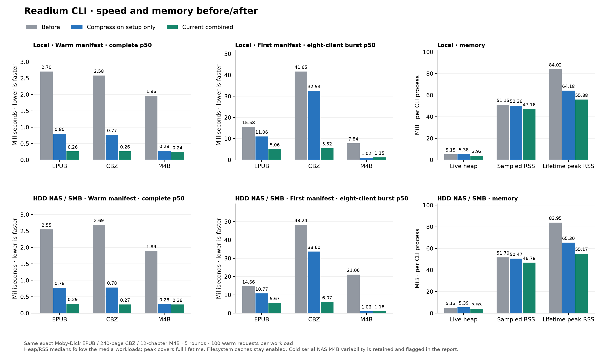

# Readium serving optimizations — 2026-10-29

The additional [100-CBZ directory case](directory-comics-2026-10-29.md) is now
included in the interactive chart's plain/Reader-selection datasets, with
registration plus first-open cost and chapter/positions validation.

Measured sources: CLI `989c2f1b3d01cc2fc06ba697373e2887f0993ca8`, toolkit
`99d1e931c3a60131ed36de4448c17312cc2826ca`. Before uses CLI `d123c32` /
toolkit `c070049` and the matched local/HDD-NAS storage baselines. The original
baseline artifacts and the first combined pass, including slow NAS samples,
remain intact. Reader's source pins are updated in a companion PR.



[Interactive comparison](optimization-2026-10-29/optimization-comparison.html)
contains every latency workload and both datasets, with first-byte/complete
response and p50/p95 controls.

## Changes and memory limits

1. `b13872c` constructs compression factories once per router instead of once
   per matched request. Compression negotiation remains enabled. A regression
   test also found that offered compression removed Range: ranged publication
   requests now preserve their offsets and remain uncompressed.
2. `9a4bca4` coordinates cold local-file publication opens by fingerprint and
   selection digest, then rechecks the cache. Followers can cancel independently;
   different publications proceed independently. Session URLs keep per-request
   rights behavior. Locks disappear after users leave. Cache rejection/errors
   can still require a later parse; no uncached publication is retained just
   to claim a coalescing hit.
3. `989c2f1` reuses serialized manifest bytes and ETags. At most one self-URL /
   indentation variant per publication is retained, with combined key/body cap
   128 KiB. Across ten entries this adds at most about 1.25 MiB plus object
   overhead; oversized responses are served without retention. Session refresh
   invalidates the response; old in-flight response bytes stay immutable.
4. Toolkit `8319231` clamps archive reads to actual entry length before allocation
   and uses at most 32 KiB for local deflate stream copying. The 2 MiB remote
   copy behavior and stored-file raw fast paths remain. Image-probe budgets,
   dimensions, publication contents and metadata are preserved.
5. Toolkit `99d1e93` synchronizes file-resource tracking and prunes closed/dead
   weak references. The regression test reproduced both request-count growth
   and concurrent append races. Tracking now follows live resources instead
   of growing with all requests during a publication's lifetime. Error paths
   also close handles acquired before an unsuccessful stat/directory check.

Publication capacity remains **10**, with the existing **600-second TTL** and
existing random offset. No larger decoded-media cache or disk-cache policy was
introduced. These measurements cover the local file/archive path (including
mounted SMB), not remote HTTP/S3/GCS archive cache tuning. The previously flagged
remote buffer-ownership/configuration questions remain for separate review.

## Latest HTTP results

Pooled nearest-rank p50/p95 milliseconds; identical fixtures, workload order,
counts and selected-media response lengths (cache-pressure manifest self URLs
may differ in length with the generated scratch namespace). Each warm row has 500 samples,
cold burst 40, serial/revisit 5, cache-pressure opens 60. Speedup is before/current
median for the same workload, never an extrapolation to full user-visible startup.
All suites ran sequentially with Go 1.26.0, GOMAXPROCS=4, GOMEMLIMIT unset, debug
mode on, identity HTTP encoding and persistent connections. Fresh CLI processes
clear publication caches, not OS or NAS caches. Client, server and profiler
settings match the saved baselines.

### local · synthetic

| Media | Workload | Before p50 / p95 | Current p50 / p95 | Median speedup |
| --- | --- | ---: | ---: | ---: |
| Synthetic EPUB | Cold manifest, serial | 5.157 / 5.372 | 3.642 / 3.863 | 1.42× |
| Synthetic EPUB | Cold manifest, 8-client burst | 11.309 / 14.024 | 3.529 / 4.481 | 3.21× |
| Synthetic EPUB | Warm manifest | 2.007 / 2.854 | 0.275 / 0.380 | 7.29× |
| Synthetic EPUB | Warm manifest, concurrency 8 | 8.275 / 15.588 | 0.269 / 0.922 | 30.78× |
| Synthetic EPUB | Warm full asset | 2.001 / 3.313 | 0.364 / 0.628 | 5.50× |
| Synthetic EPUB | Warm full asset, concurrency 8 | 7.358 / 13.843 | 0.570 / 1.521 | 12.90× |
| Synthetic EPUB | Warm prefix range | 1.974 / 2.996 | 0.383 / 0.635 | 5.15× |
| Synthetic EPUB | Cache-pressure opens | 4.669 / 7.082 | 2.480 / 3.646 | 1.88× |
| Synthetic EPUB | Revisit after cache pressure | 3.130 / 3.565 | 0.349 / 0.448 | 8.97× |
| 240-page CBZ | Cold manifest, serial | 10.344 / 11.478 | 6.016 / 7.311 | 1.72× |
| 240-page CBZ | Cold manifest, 8-client burst | 39.254 / 52.146 | 6.353 / 7.798 | 6.18× |
| 240-page CBZ | Warm manifest | 2.617 / 3.716 | 0.276 / 0.370 | 9.48× |
| 240-page CBZ | Warm manifest, concurrency 8 | 8.894 / 16.967 | 0.246 / 0.736 | 36.08× |
| 240-page CBZ | Warm full asset | 1.959 / 3.101 | 0.373 / 0.585 | 5.25× |
| 240-page CBZ | Warm full asset, concurrency 8 | 8.042 / 15.207 | 0.473 / 1.448 | 17.00× |
| 240-page CBZ | Warm prefix range | 2.048 / 3.156 | 0.333 / 0.535 | 6.16× |
| 240-page CBZ | Cache-pressure opens | 10.188 / 13.325 | 5.538 / 7.178 | 1.84× |
| 240-page CBZ | Revisit after cache pressure | 9.155 / 9.919 | 0.353 / 0.427 | 25.91× |
| 60-second WAV | Cold manifest, serial | 2.501 / 3.271 | 1.000 / 1.462 | 2.50× |
| 60-second WAV | Cold manifest, 8-client burst | 8.997 / 13.493 | 0.999 / 1.459 | 9.01× |
| 60-second WAV | Warm manifest | 1.967 / 3.237 | 0.245 / 0.312 | 8.04× |
| 60-second WAV | Warm manifest, concurrency 8 | 7.542 / 14.254 | 0.218 / 0.410 | 34.63× |
| 60-second WAV | Warm full asset | 2.683 / 3.922 | 0.900 / 1.343 | 2.98× |
| 60-second WAV | Warm full asset, concurrency 8 | 7.599 / 14.008 | 1.144 / 1.941 | 6.64× |
| 60-second WAV | Warm prefix range | 1.958 / 3.332 | 0.291 / 0.396 | 6.72× |
| 60-second WAV | Cache-pressure opens | 2.631 / 3.920 | 0.905 / 1.326 | 2.91× |
| 60-second WAV | Revisit after cache pressure | 2.056 / 2.759 | 0.334 / 0.409 | 6.17× |

### local · moby-m4b

| Media | Workload | Before p50 / p95 | Current p50 / p95 | Median speedup |
| --- | --- | ---: | ---: | ---: |
| Moby-Dick EPUB | Cold manifest, serial | 6.411 / 7.991 | 4.107 / 4.550 | 1.56× |
| Moby-Dick EPUB | Cold manifest, 8-client burst | 15.577 / 19.311 | 5.058 / 5.674 | 3.08× |
| Moby-Dick EPUB | Warm manifest | 2.703 / 4.097 | 0.261 / 0.364 | 10.37× |
| Moby-Dick EPUB | Warm manifest, concurrency 8 | 10.046 / 19.465 | 0.253 / 0.679 | 39.67× |
| Moby-Dick EPUB | Warm full asset | 1.940 / 3.374 | 0.360 / 0.548 | 5.40× |
| Moby-Dick EPUB | Warm full asset, concurrency 8 | 7.672 / 14.623 | 0.429 / 1.146 | 17.90× |
| Moby-Dick EPUB | Warm prefix range | 2.020 / 3.207 | 0.366 / 0.563 | 5.52× |
| Moby-Dick EPUB | Cache-pressure opens | 6.269 / 8.399 | 4.129 / 5.281 | 1.52× |
| Moby-Dick EPUB | Revisit after cache pressure | 3.217 / 3.472 | 0.405 / 0.765 | 7.94× |
| 240-page CBZ | Cold manifest, serial | 10.218 / 15.525 | 5.877 / 7.627 | 1.74× |
| 240-page CBZ | Cold manifest, 8-client burst | 41.645 / 55.246 | 5.523 / 7.703 | 7.54× |
| 240-page CBZ | Warm manifest | 2.581 / 3.812 | 0.265 / 0.394 | 9.76× |
| 240-page CBZ | Warm manifest, concurrency 8 | 9.098 / 19.109 | 0.237 / 0.745 | 38.34× |
| 240-page CBZ | Warm full asset | 2.021 / 3.929 | 0.336 / 0.562 | 6.02× |
| 240-page CBZ | Warm full asset, concurrency 8 | 7.224 / 14.072 | 0.488 / 1.563 | 14.79× |
| 240-page CBZ | Warm prefix range | 2.136 / 3.662 | 0.332 / 0.539 | 6.44× |
| 240-page CBZ | Cache-pressure opens | 11.227 / 13.209 | 5.451 / 7.595 | 2.06× |
| 240-page CBZ | Revisit after cache pressure | 11.076 / 13.394 | 0.422 / 0.532 | 26.24× |
| 12-chapter M4B | Cold manifest, serial | 3.421 / 3.800 | 1.055 / 1.689 | 3.24× |
| 12-chapter M4B | Cold manifest, 8-client burst | 7.837 / 10.595 | 1.151 / 1.522 | 6.81× |
| 12-chapter M4B | Warm manifest | 1.964 / 3.410 | 0.238 / 0.322 | 8.24× |
| 12-chapter M4B | Warm manifest, concurrency 8 | 7.578 / 14.892 | 0.207 / 0.383 | 36.52× |
| 12-chapter M4B | Warm full asset | 1.848 / 3.126 | 0.338 / 0.495 | 5.48× |
| 12-chapter M4B | Warm full asset, concurrency 8 | 7.507 / 17.802 | 0.306 / 0.606 | 24.54× |
| 12-chapter M4B | Warm prefix range | 2.039 / 3.720 | 0.290 / 0.395 | 7.03× |
| 12-chapter M4B | Cache-pressure opens | 2.908 / 4.476 | 0.882 / 1.204 | 3.30× |
| 12-chapter M4B | Revisit after cache pressure | 2.982 / 4.189 | 0.281 / 0.372 | 10.61× |

### nas · synthetic

| Media | Workload | Before p50 / p95 | Current p50 / p95 | Median speedup |
| --- | --- | ---: | ---: | ---: |
| Synthetic EPUB | Cold manifest, serial | 5.639 / 6.245 | 3.344 / 5.752 | 1.69× |
| Synthetic EPUB | Cold manifest, 8-client burst | 12.052 / 15.746 | 3.265 / 3.931 | 3.69× |
| Synthetic EPUB | Warm manifest | 2.295 / 3.426 | 0.288 / 0.401 | 7.98× |
| Synthetic EPUB | Warm manifest, concurrency 8 | 8.022 / 16.341 | 0.275 / 0.832 | 29.17× |
| Synthetic EPUB | Warm full asset | 1.996 / 3.134 | 0.376 / 0.645 | 5.30× |
| Synthetic EPUB | Warm full asset, concurrency 8 | 6.971 / 13.695 | 0.633 / 1.550 | 11.01× |
| Synthetic EPUB | Warm prefix range | 1.965 / 3.105 | 0.387 / 0.619 | 5.08× |
| Synthetic EPUB | Cache-pressure opens | 10.682 / 14.058 | 10.687 / 17.521 | 1.00× |
| Synthetic EPUB | Revisit after cache pressure | 2.557 / 2.877 | 0.461 / 0.511 | 5.55× |
| 240-page CBZ | Cold manifest, serial | 11.527 / 14.517 | 7.429 / 9.508 | 1.55× |
| 240-page CBZ | Cold manifest, 8-client burst | 40.472 / 49.566 | 6.524 / 7.215 | 6.20× |
| 240-page CBZ | Warm manifest | 2.631 / 3.660 | 0.280 / 0.409 | 9.41× |
| 240-page CBZ | Warm manifest, concurrency 8 | 8.217 / 15.739 | 0.257 / 0.712 | 32.00× |
| 240-page CBZ | Warm full asset | 1.806 / 3.036 | 0.348 / 0.637 | 5.19× |
| 240-page CBZ | Warm full asset, concurrency 8 | 7.002 / 12.693 | 0.536 / 1.734 | 13.07× |
| 240-page CBZ | Warm prefix range | 1.816 / 2.868 | 0.361 / 0.927 | 5.03× |
| 240-page CBZ | Cache-pressure opens | 54.909 / 67.956 | 59.268 / 117.614 | 0.93× |
| 240-page CBZ | Revisit after cache pressure | 10.407 / 11.473 | 0.498 / 0.577 | 20.91× |
| 60-second WAV | Cold manifest, serial | 2.560 / 2.867 | 20.418 / 28.550 | 0.13× |
| 60-second WAV | Cold manifest, 8-client burst | 30.277 / 79.722 | 1.039 / 1.669 | 29.14× |
| 60-second WAV | Warm manifest | 1.928 / 3.044 | 0.252 / 0.379 | 7.65× |
| 60-second WAV | Warm manifest, concurrency 8 | 6.968 / 14.261 | 0.202 / 0.379 | 34.53× |
| 60-second WAV | Warm full asset | 2.809 / 4.105 | 1.018 / 1.753 | 2.76× |
| 60-second WAV | Warm full asset, concurrency 8 | 7.792 / 14.234 | 1.301 / 2.917 | 5.99× |
| 60-second WAV | Warm prefix range | 1.917 / 2.920 | 0.360 / 0.593 | 5.32× |
| 60-second WAV | Cache-pressure opens | 21.608 / 31.199 | 23.226 / 36.265 | 0.93× |
| 60-second WAV | Revisit after cache pressure | 20.046 / 28.863 | 0.354 / 0.424 | 56.67× |

### nas · moby-m4b

| Media | Workload | Before p50 / p95 | Current p50 / p95 | Median speedup |
| --- | --- | ---: | ---: | ---: |
| Moby-Dick EPUB | Cold manifest, serial | 7.427 / 7.465 | 4.815 / 5.664 | 1.54× |
| Moby-Dick EPUB | Cold manifest, 8-client burst | 14.662 / 19.780 | 5.665 / 8.718 | 2.59× |
| Moby-Dick EPUB | Warm manifest | 2.548 / 3.484 | 0.285 / 0.403 | 8.93× |
| Moby-Dick EPUB | Warm manifest, concurrency 8 | 8.660 / 16.892 | 0.262 / 0.701 | 33.07× |
| Moby-Dick EPUB | Warm full asset | 2.058 / 3.092 | 0.382 / 0.660 | 5.39× |
| Moby-Dick EPUB | Warm full asset, concurrency 8 | 7.426 / 14.180 | 0.459 / 1.231 | 16.16× |
| Moby-Dick EPUB | Warm prefix range | 1.972 / 3.084 | 0.384 / 0.606 | 5.13× |
| Moby-Dick EPUB | Cache-pressure opens | 12.466 / 16.169 | 13.114 / 18.550 | 0.95× |
| Moby-Dick EPUB | Revisit after cache pressure | 2.843 / 3.724 | 0.426 / 0.499 | 6.67× |
| 240-page CBZ | Cold manifest, serial | 11.499 / 12.661 | 7.830 / 9.825 | 1.47× |
| 240-page CBZ | Cold manifest, 8-client burst | 48.241 / 52.523 | 6.067 / 6.366 | 7.95× |
| 240-page CBZ | Warm manifest | 2.688 / 3.705 | 0.266 / 0.343 | 10.12× |
| 240-page CBZ | Warm manifest, concurrency 8 | 9.010 / 17.204 | 0.275 / 0.869 | 32.72× |
| 240-page CBZ | Warm full asset | 2.079 / 3.131 | 0.341 / 0.581 | 6.10× |
| 240-page CBZ | Warm full asset, concurrency 8 | 7.697 / 14.933 | 0.482 / 1.459 | 15.96× |
| 240-page CBZ | Warm prefix range | 1.974 / 3.083 | 0.354 / 0.629 | 5.58× |
| 240-page CBZ | Cache-pressure opens | 54.398 / 71.051 | 55.426 / 75.853 | 0.98× |
| 240-page CBZ | Revisit after cache pressure | 9.296 / 12.165 | 0.411 / 0.453 | 22.60× |
| 12-chapter M4B | Cold manifest, serial | 2.712 / 3.866 | 10.406 / 17.564 | 0.26× |
| 12-chapter M4B | Cold manifest, 8-client burst | 21.058 / 35.263 | 1.179 / 1.650 | 17.87× |
| 12-chapter M4B | Warm manifest | 1.893 / 3.037 | 0.263 / 0.369 | 7.19× |
| 12-chapter M4B | Warm manifest, concurrency 8 | 6.935 / 13.327 | 0.244 / 0.522 | 28.46× |
| 12-chapter M4B | Warm full asset | 1.855 / 3.046 | 0.372 / 0.612 | 4.98× |
| 12-chapter M4B | Warm full asset, concurrency 8 | 6.754 / 12.285 | 0.327 / 0.598 | 20.67× |
| 12-chapter M4B | Warm prefix range | 1.889 / 3.060 | 0.294 / 0.396 | 6.43× |
| 12-chapter M4B | Cache-pressure opens | 13.409 / 16.695 | 14.042 / 26.013 | 0.95× |
| 12-chapter M4B | Revisit after cache pressure | 11.247 / 11.547 | 0.449 / 0.455 | 25.06× |

## Process memory

Moby-Dick/CBZ/M4B, median MiB after all media workloads and forced GC. Peak
is the highest lifetime RSS across rounds, including cache pressure. These
are per-CLI-process figures, excluding kernel filesystem caches and NAS RAM.

| Storage | Metric | Before | Current | Reduction |
| --- | --- | ---: | ---: | ---: |
| local | Live heap | 5.15 | 3.92 | 23.8% |
| local | Reserved heap | 55.09 | 19.03 | 65.5% |
| local | Sampled RSS | 51.15 | 47.16 | 7.8% |
| local | Lifetime peak RSS | 84.02 | 55.88 | 33.5% |
| nas | Live heap | 5.13 | 3.93 | 23.4% |
| nas | Reserved heap | 59.06 | 19.09 | 67.7% |
| nas | Sampled RSS | 51.70 | 46.78 | 9.5% |
| nas | Lifetime peak RSS | 83.95 | 55.17 | 34.3% |

## Allocations and toolkit open cost

Median of five synthetic-fixture Go benchmark runs. These exclude network/client
allocation. B/op is allocation churn, not retained heap; cache open/close includes
eviction and toolkit parsing. The warm WAV asset benchmark is a 64 KiB range.

### local

| Benchmark | Before µs / B/op | Current µs / B/op | Median speedup |
| --- | ---: | ---: | ---: |
| Serving/book.epub/manifest | 1,888.339 / 6,336,730 | 13.191 / 4,838 | 143.15× |
| Serving/book.epub/asset | 1,591.518 / 6,258,480 | 133.928 / 84,764 | 11.88× |
| Serving/comic.cbz/manifest | 2,074.119 / 6,375,951 | 13.573 / 4,832 | 152.81× |
| Serving/comic.cbz/asset | 1,488.031 / 6,220,551 | 101.167 / 85,988 | 14.71× |
| Serving/audio.wav/manifest | 1,405.560 / 6,143,238 | 14.827 / 4,838 | 94.80× |
| Serving/audio.wav/asset | 1,455.242 / 6,138,744 | 34.754 / 6,096 | 41.87× |
| PublicationCache/book.epub/hit | 2.818 / 808 | 2.782 / 808 | 1.01× |
| PublicationCache/book.epub/open_close | 1,833.899 / 988,527 | 1,694.506 / 988,779 | 1.08× |
| PublicationCache/comic.cbz/hit | 2.727 / 808 | 2.786 / 808 | 0.98× |
| PublicationCache/comic.cbz/open_close | 7,320.466 / 18,178,590 | 4,408.463 / 5,890,746 | 1.66× |
| PublicationCache/audio.wav/hit | 2.748 / 808 | 2.563 / 808 | 1.07× |
| PublicationCache/audio.wav/open_close | 314.074 / 392,525 | 276.600 / 392,782 | 1.14× |

### nas

| Benchmark | Before µs / B/op | Current µs / B/op | Median speedup |
| --- | ---: | ---: | ---: |
| Serving/book.epub/manifest | 1,850.954 / 6,340,483 | 17.130 / 4,841 | 108.05× |
| Serving/book.epub/asset | 1,706.343 / 6,259,880 | 149.799 / 84,889 | 11.39× |
| Serving/comic.cbz/manifest | 2,060.642 / 6,373,417 | 18.071 / 4,842 | 114.03× |
| Serving/comic.cbz/asset | 1,635.587 / 6,219,453 | 97.342 / 86,096 | 16.80× |
| Serving/audio.wav/manifest | 1,435.434 / 6,144,449 | 16.860 / 4,843 | 85.14× |
| Serving/audio.wav/asset | 1,528.232 / 6,141,158 | 42.959 / 6,102 | 35.57× |
| PublicationCache/book.epub/hit | 3.376 / 808 | 3.231 / 808 | 1.04× |
| PublicationCache/book.epub/open_close | 1,877.948 / 988,260 | 1,824.414 / 988,933 | 1.03× |
| PublicationCache/comic.cbz/hit | 3.377 / 808 | 3.115 / 808 | 1.08× |
| PublicationCache/comic.cbz/open_close | 7,647.468 / 18,178,676 | 4,325.104 / 5,890,716 | 1.77× |
| PublicationCache/audio.wav/hit | 3.329 / 808 | 2.927 / 808 | 1.14× |
| PublicationCache/audio.wav/open_close | 370.267 / 392,527 | 300.059 / 392,779 | 1.23× |

## Regressions, variability and human review

**NAS serial cold M4B remains a review item.** The first combined pass measured
15.956 ms median / 127.572 ms maximum across five samples; the current full run
measured 10.406 / 17.564 ms versus baseline 2.712 / 3.866 ms. Both raw runs are
retained rather than discarded. This is the notable slower row; do not claim a
cold single-open improvement for NAS M4B from these full runs.

A controlled recheck alternated before, compression-only and first-combined binaries
(the first-combined toolkit was `8319231`, before the tracking fix)
for 30 fresh-process trials each, opening EPUB, CBZ and M4B in the same order.
M4B before p50/p95/max was 2.445/3.761/15.873 ms; combined was
0.995/1.706/2.060 ms. It did not reproduce an optimized-only regression.
The controlled check excludes the full suite's warm/cache-pressure phases and
therefore does not resolve the full-suite discrepancy. Raw records are in
`cold-nas-diagnostic.json`. A separate instrumented three-round run retained in
`nas-io-diagnostic.json` showed filesystem stalls (including pread64 calls around
125 ms, and mount open/stat delays); the bounded syscall summary is in
`nas-io-summary.txt`. strace timings are diagnostic, not benchmark results.
The exact interaction between workload history, SMB/filesystem behavior and
process timing is not isolated. Human review/qualification of this NAS cold
case is needed before general rollout; changing NAS mount/cache settings is
outside this change.

A second alternating check uses the **current tracking-fixed binary** for 30
trials per variant. M4B p50 / p95 / max: before: 2.456 / 4.006 / 38.678 ms; after: 1.023 / 1.666 / 1.691 ms.
The binary hashes and records are retained in `cold-nas-current.json`. This
also excludes the full warm/cache-pressure history, so the full-suite cold
case remains a human-review item. Reproduce the controlled check with:

```sh
GOMAXPROCS=4 READIUM_COMPARE_BEFORE=/path/before READIUM_COMPARE_AFTER=/path/current READIUM_COMPARE_LIBRARY=/mnt/Media/Reader_Testing/moby-m4b READIUM_COMPARE_OUTPUT=/path/new-output.json go test ./tools/servebench -run '^TestCompareColdOpens$' -count=1
```

Other rows, including slower/noisy samples, remain in the tables. Revisit
speedups are policy-dependent cache hits/misses and have only five samples;
use warm requests and larger cold-burst samples for the primary comparison.
No production memory ceiling, remote-cache speedup, Windows/macOS runtime gain,
full Reader-to-client speedup or uncached HDD throughput is inferred.

## Validation and reproduction

- Full CLI suite and serving/cache/harness race suites pass.
- Full toolkit suite plus affected archive/analyzer/image/audio/fetcher race
  suites pass with verified actual Git LFS fixtures. Original pointer files
  were restored; no downloaded fixture contents were committed.
- Regression coverage includes compression negotiation under concurrency,
  compressed-offer Range/HEAD, cold-open sharing/cancellation, bounded response
  variants and session invalidation, extreme/clamped archive ranges, local
  stream chunk sizes, resource-list growth and concurrent Get/Close lifecycles.
- Reader protocol tests pass (three suites, 18 tests).
- Original fixture SHA-256s, reading-order/TOC counts, duration and HTTP response
  length/prefix checks pass on every local/NAS dataset. No dimensions or reading
  order were removed as a performance shortcut.
- Actual CLI cross-builds pass for Windows amd64 and macOS arm64 with CGO disabled.
  Runtime measurements here are Linux/WSL only.

Use the [same baseline methodology](README.md), pointing `--binary` at the rebuilt
current executable and `--library-dir` at the retained local or NAS fixture set.
Use `READIUM_BENCH_LIBRARY` for Go benchmarks/profiles. Compare exact source
revisions and fixture hashes. Rebuild this report and PNG/HTML with
`python tools/servebench/compare_optimization.py` (matplotlib needed for reporting).

The `optimization-2026-10-29/` directory retains compression-only snapshots,
first-combined-pass raw samples, current raw samples, Go benchmarks, profiles,
validation output, and the NAS diagnostic records. The original local/HDD-NAS
baselines are unchanged. The pre-existing local go.mod replacement remains
uncommitted; Reader's reproducible build already supplies the pinned toolkit
checkout explicitly.
