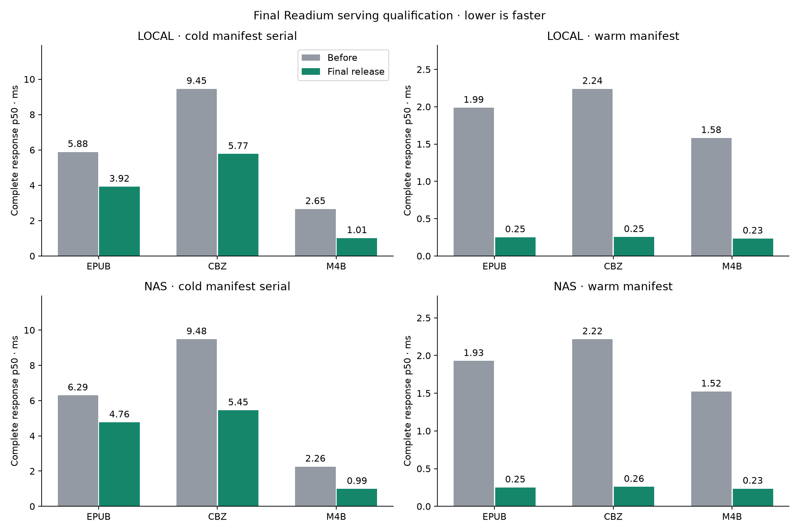

# Final serving release qualification

This report supersedes the previous combined candidate. The release keeps
compression-adapter reuse, correct uncompressed Range handling, bounded manifest
serialization caching, archive allocation/stream-buffer bounds and synchronized
file-resource tracking. **Cold-open coalescing is excluded** after its full-history
NAS regression reproduced. It can be investigated separately; its earlier burst
improvements are not claimed for this release.

Final production source: CLI `5a974b4d885b0fcdfff84548db661657af482d43`, toolkit
`99d1e931c3a60131ed36de4448c17312cc2826ca`. The CLI now pins the reviewed toolkit
pseudo-version and builds without an absolute/local replacement. The before
binary is CLI `d123c32580915b722464f3a9c5dd8eb42a68e0ee` / toolkit `c070049`.

## NAS audiobook merge gate

The unchanged full workload reproduced the earlier adverse result. A fresh CLI
process alone did not expose it: later rounds after the burst/warm/cache-pressure
phases did. Compression-only stayed fast; using the baseline toolkit with the
current CLI still reproduced it. Removing only cold-open serialization removed
the symptom; removing only manifest caching did not. A diagnostic syscall trace
placed the waiting time in NAS reads, including ZIP tail probes on the raw M4B.
This identifies the triggering CLI change, not a proven SMB/kernel mechanism.
No NAS mount/cache settings or benchmark pauses were changed to obtain a pass.

| Full-history check | Cold M4B complete median, ms |
| --- | ---: |
| Adverse-run baseline A | 2.153 |
| Previous candidate B | 7.415 |
| Previous candidate B repeated | 8.800 |
| Adverse-run baseline A repeated | 2.203 |
| Final qualification A | 2.390 |
| Final release B | 0.960 |
| Final release B repeated | 1.084 |
| Final qualification A repeated | 2.255 |

Each batch has five fresh-process rounds, 100 requests per warm workload and
eight concurrent clients. Final NAS M4B uses ABBA order (ten cold samples per
variant); other datasets use five rounds per variant. All measured suites ran
sequentially without concurrent builds/tests, Go 1.26.0, GOMAXPROCS=4, debug mode,
identity encoding and persistent connections. Cold means publication/process
caches, with OS/NAS filesystem caches uncontrolled. These are loopback CLI
timings, not click-to-render or physical cold-HDD measurements.

## Current comparison

[Interactive comparison of every workload](release-qualification-2026-10-29/comparison.html)
includes complete/first-byte p50 and p95, both storage locations, generated and
real-media fixtures, and plain/Reader-selected directory comics.
Percentiles pool individual requests; cold serial estimates have only 5–10
samples. Historical adverse samples remain available beside the final results.

### local · moby-m4b

| Media | Workload | Before p50 / p95 ms | Release p50 / p95 ms | Median speedup |
| --- | --- | ---: | ---: | ---: |
| EPUB | cache_pressure_open | 4.913 / 5.590 | 3.360 / 4.701 | 1.46× |
| EPUB | cache_pressure_revisit | 2.527 / 2.681 | 0.349 / 0.412 | 7.24× |
| EPUB | cold_manifest_burst | 12.318 / 15.897 | 9.932 / 13.565 | 1.24× |
| EPUB | cold_manifest_serial | 5.884 / 6.125 | 3.922 / 4.754 | 1.50× |
| EPUB | warm_asset | 1.670 / 2.466 | 0.337 / 0.425 | 4.95× |
| EPUB | warm_asset_concurrent | 5.696 / 10.806 | 0.379 / 0.970 | 15.05× |
| EPUB | warm_manifest | 1.986 / 2.632 | 0.251 / 0.301 | 7.91× |
| EPUB | warm_manifest_concurrent | 7.038 / 13.065 | 0.251 / 0.675 | 28.10× |
| EPUB | warm_range | 1.709 / 2.425 | 0.347 / 0.423 | 4.92× |
| CBZ | cache_pressure_open | 9.075 / 10.297 | 5.017 / 5.651 | 1.81× |
| CBZ | cache_pressure_revisit | 8.941 / 9.763 | 4.697 / 5.611 | 1.90× |
| CBZ | cold_manifest_burst | 32.458 / 40.204 | 16.443 / 19.258 | 1.97× |
| CBZ | cold_manifest_serial | 9.452 / 11.340 | 5.769 / 5.947 | 1.64× |
| CBZ | warm_asset | 1.515 / 2.366 | 0.308 / 0.416 | 4.92× |
| CBZ | warm_asset_concurrent | 5.824 / 11.209 | 0.396 / 1.202 | 14.69× |
| CBZ | warm_manifest | 2.239 / 3.042 | 0.254 / 0.315 | 8.80× |
| CBZ | warm_manifest_concurrent | 7.032 / 12.800 | 0.185 / 0.399 | 38.03× |
| CBZ | warm_range | 1.603 / 2.398 | 0.319 / 0.410 | 5.03× |
| M4B | cache_pressure_open | 2.157 / 2.888 | 0.783 / 1.134 | 2.76× |
| M4B | cache_pressure_revisit | 1.751 / 1.842 | 0.659 / 0.689 | 2.66× |
| M4B | cold_manifest_burst | 6.396 / 7.656 | 1.028 / 1.269 | 6.22× |
| M4B | cold_manifest_serial | 2.654 / 3.553 | 1.008 / 1.586 | 2.63× |
| M4B | warm_asset | 1.538 / 2.326 | 0.337 / 0.402 | 4.56× |
| M4B | warm_asset_concurrent | 5.441 / 10.516 | 0.272 / 0.726 | 19.98× |
| M4B | warm_manifest | 1.580 / 2.307 | 0.233 / 0.282 | 6.78× |
| M4B | warm_manifest_concurrent | 5.381 / 10.203 | 0.211 / 0.414 | 25.47× |
| M4B | warm_range | 1.561 / 2.364 | 0.278 / 0.324 | 5.61× |

### local · synthetic

| Media | Workload | Before p50 / p95 ms | Release p50 / p95 ms | Median speedup |
| --- | --- | ---: | ---: | ---: |
| EPUB | cache_pressure_open | 3.779 / 4.531 | 2.159 / 3.501 | 1.75× |
| EPUB | cache_pressure_revisit | 2.069 / 2.693 | 0.325 / 0.371 | 6.36× |
| EPUB | cold_manifest_burst | 10.158 / 12.512 | 7.336 / 9.067 | 1.38× |
| EPUB | cold_manifest_serial | 5.591 / 7.189 | 2.916 / 3.651 | 1.92× |
| EPUB | warm_asset | 1.576 / 2.328 | 0.337 / 0.431 | 4.67× |
| EPUB | warm_asset_concurrent | 5.621 / 10.201 | 0.494 / 1.291 | 11.39× |
| EPUB | warm_manifest | 1.727 / 2.345 | 0.261 / 0.317 | 6.63× |
| EPUB | warm_manifest_concurrent | 6.752 / 12.650 | 0.209 / 0.442 | 32.26× |
| EPUB | warm_range | 1.629 / 2.303 | 0.345 / 0.436 | 4.72× |
| CBZ | cache_pressure_open | 8.833 / 9.747 | 5.062 / 5.746 | 1.75× |
| CBZ | cache_pressure_revisit | 8.610 / 8.728 | 4.755 / 5.476 | 1.81× |
| CBZ | cold_manifest_burst | 38.072 / 41.756 | 17.096 / 19.933 | 2.23× |
| CBZ | cold_manifest_serial | 9.301 / 10.245 | 6.112 / 6.344 | 1.52× |
| CBZ | warm_asset | 1.546 / 2.315 | 0.316 / 0.394 | 4.90× |
| CBZ | warm_asset_concurrent | 5.883 / 10.322 | 0.382 / 1.190 | 15.42× |
| CBZ | warm_manifest | 2.225 / 2.965 | 0.257 / 0.323 | 8.65× |
| CBZ | warm_manifest_concurrent | 6.996 / 13.188 | 0.211 / 0.598 | 33.14× |
| CBZ | warm_range | 1.591 / 2.335 | 0.323 / 0.405 | 4.92× |
| WAV | cache_pressure_open | 1.988 / 2.885 | 0.761 / 1.092 | 2.61× |
| WAV | cache_pressure_revisit | 2.033 / 3.131 | 0.631 / 0.703 | 3.22× |
| WAV | cold_manifest_burst | 6.335 / 7.514 | 0.804 / 1.006 | 7.88× |
| WAV | cold_manifest_serial | 2.559 / 3.459 | 0.779 / 1.266 | 3.28× |
| WAV | warm_asset | 2.106 / 3.121 | 0.805 / 1.110 | 2.62× |
| WAV | warm_asset_concurrent | 6.088 / 11.805 | 1.011 / 1.703 | 6.02× |
| WAV | warm_manifest | 1.559 / 2.365 | 0.237 / 0.277 | 6.57× |
| WAV | warm_manifest_concurrent | 5.731 / 10.506 | 0.202 / 0.470 | 28.39× |
| WAV | warm_range | 1.604 / 2.395 | 0.292 / 0.344 | 5.48× |

### local · directory

| Media | Workload | Before p50 / p95 ms | Release p50 / p95 ms | Median speedup |
| --- | --- | ---: | ---: | ---: |
| 100 chapters · plain | chapter_cache_pressure_open | 2.435 / 3.304 | 0.878 / 1.501 | 2.77× |
| 100 chapters · plain | cold_manifest_burst | 10.800 / 13.963 | 8.132 / 10.599 | 1.33× |
| 100 chapters · plain | cold_manifest_serial | 6.001 / 6.362 | 3.475 / 3.543 | 1.73× |
| 100 chapters · plain | parent_revisit_after_12_chapters | 2.386 / 3.403 | 0.290 / 0.301 | 8.23× |
| 100 chapters · plain | warm_chapter_archive | 1.546 / 2.193 | 0.363 / 0.421 | 4.26× |
| 100 chapters · plain | warm_chapter_archive_concurrent | 5.466 / 10.455 | 0.348 / 1.259 | 15.69× |
| 100 chapters · plain | warm_chapter_range | 1.505 / 2.229 | 0.313 / 0.380 | 4.81× |
| 100 chapters · plain | warm_child_manifest | 1.507 / 2.120 | 0.239 / 0.292 | 6.31× |
| 100 chapters · plain | warm_manifest | 1.881 / 2.660 | 0.245 / 0.305 | 7.67× |
| 100 chapters · plain | warm_manifest_concurrent | 6.523 / 12.195 | 0.215 / 0.712 | 30.40× |
| 100 chapters · plain | warm_positions | 2.107 / 2.792 | 0.682 / 1.122 | 3.09× |
| 100 chapters · Reader selection | chapter_cache_pressure_open | 2.619 / 3.571 | 0.864 / 1.416 | 3.03× |
| 100 chapters · Reader selection | cold_manifest_burst | 7.427 / 9.163 | 1.087 / 1.360 | 6.83× |
| 100 chapters · Reader selection | cold_manifest_serial | 2.613 / 3.046 | 1.147 / 2.017 | 2.28× |
| 100 chapters · Reader selection | cold_selected_open_total | 6.539 / 7.237 | 4.426 / 5.576 | 1.48× |
| 100 chapters · Reader selection | parent_revisit_after_12_chapters | 2.723 / 3.621 | 0.304 / 0.306 | 8.95× |
| 100 chapters · Reader selection | selection_register | 4.065 / 4.156 | 3.171 / 3.445 | 1.28× |
| 100 chapters · Reader selection | warm_chapter_archive | 1.640 / 2.414 | 0.371 / 0.455 | 4.42× |
| 100 chapters · Reader selection | warm_chapter_archive_concurrent | 5.463 / 10.303 | 0.376 / 1.180 | 14.54× |
| 100 chapters · Reader selection | warm_chapter_range | 1.663 / 2.354 | 0.317 / 0.382 | 5.24× |
| 100 chapters · Reader selection | warm_child_manifest | 1.613 / 2.286 | 0.241 / 0.295 | 6.69× |
| 100 chapters · Reader selection | warm_manifest | 1.910 / 2.742 | 0.255 / 0.313 | 7.49× |
| 100 chapters · Reader selection | warm_manifest_concurrent | 6.566 / 11.876 | 0.198 / 0.502 | 33.18× |
| 100 chapters · Reader selection | warm_positions | 1.989 / 2.798 | 0.695 / 1.194 | 2.86× |

### nas · moby-m4b

| Media | Workload | Before p50 / p95 ms | Release p50 / p95 ms | Median speedup |
| --- | --- | ---: | ---: | ---: |
| EPUB | cache_pressure_open | 10.915 / 26.462 | 9.753 / 17.212 | 1.12× |
| EPUB | cache_pressure_revisit | 2.412 / 3.972 | 0.352 / 0.448 | 6.85× |
| EPUB | cold_manifest_burst | 11.671 / 15.555 | 10.187 / 13.315 | 1.15× |
| EPUB | cold_manifest_serial | 6.294 / 7.553 | 4.762 / 5.089 | 1.32× |
| EPUB | warm_asset | 1.572 / 2.265 | 0.343 / 0.427 | 4.58× |
| EPUB | warm_asset_concurrent | 5.521 / 10.518 | 0.377 / 1.060 | 14.66× |
| EPUB | warm_manifest | 1.928 / 2.627 | 0.251 / 0.315 | 7.68× |
| EPUB | warm_manifest_concurrent | 6.965 / 12.926 | 0.212 / 0.583 | 32.84× |
| EPUB | warm_range | 1.621 / 2.389 | 0.349 / 0.426 | 4.65× |
| CBZ | cache_pressure_open | 48.686 / 70.606 | 46.825 / 70.739 | 1.04× |
| CBZ | cache_pressure_revisit | 9.264 / 11.599 | 5.062 / 5.388 | 1.83× |
| CBZ | cold_manifest_burst | 32.793 / 39.079 | 16.945 / 20.463 | 1.94× |
| CBZ | cold_manifest_serial | 9.479 / 11.075 | 5.447 / 5.800 | 1.74× |
| CBZ | warm_asset | 1.565 / 2.390 | 0.316 / 0.396 | 4.95× |
| CBZ | warm_asset_concurrent | 5.674 / 11.019 | 0.377 / 1.191 | 15.05× |
| CBZ | warm_manifest | 2.216 / 3.025 | 0.259 / 0.314 | 8.56× |
| CBZ | warm_manifest_concurrent | 6.945 / 13.474 | 0.206 / 0.625 | 33.70× |
| CBZ | warm_range | 1.562 / 2.401 | 0.326 / 0.409 | 4.79× |
| M4B | cache_pressure_open | 11.241 / 17.171 | 9.938 / 20.105 | 1.13× |
| M4B | cache_pressure_revisit | 8.912 / 68.224 | 7.587 / 11.763 | 1.17× |
| M4B | cold_manifest_burst | 17.328 / 29.084 | 0.995 / 1.224 | 17.41× |
| M4B | cold_manifest_serial | 2.255 / 2.873 | 0.986 / 1.486 | 2.29× |
| M4B | warm_asset | 1.511 / 2.369 | 0.339 / 0.418 | 4.45× |
| M4B | warm_asset_concurrent | 5.569 / 10.512 | 0.297 / 0.738 | 18.78× |
| M4B | warm_manifest | 1.523 / 2.292 | 0.234 / 0.279 | 6.50× |
| M4B | warm_manifest_concurrent | 5.402 / 10.231 | 0.204 / 0.337 | 26.44× |
| M4B | warm_range | 1.497 / 2.334 | 0.288 / 0.341 | 5.19× |

### nas · synthetic

| Media | Workload | Before p50 / p95 ms | Release p50 / p95 ms | Median speedup |
| --- | --- | ---: | ---: | ---: |
| EPUB | cache_pressure_open | 9.220 / 14.832 | 7.761 / 16.394 | 1.19× |
| EPUB | cache_pressure_revisit | 2.163 / 2.379 | 0.358 / 1.089 | 6.05× |
| EPUB | cold_manifest_burst | 9.979 / 11.561 | 7.442 / 9.072 | 1.34× |
| EPUB | cold_manifest_serial | 4.815 / 5.661 | 3.426 / 3.578 | 1.41× |
| EPUB | warm_asset | 1.607 / 2.375 | 0.344 / 0.483 | 4.67× |
| EPUB | warm_asset_concurrent | 5.791 / 10.954 | 0.502 / 1.414 | 11.54× |
| EPUB | warm_manifest | 1.740 / 2.256 | 0.265 / 0.327 | 6.56× |
| EPUB | warm_manifest_concurrent | 6.773 / 12.501 | 0.177 / 0.369 | 38.35× |
| EPUB | warm_range | 1.608 / 2.226 | 0.356 / 0.486 | 4.51× |
| CBZ | cache_pressure_open | 49.357 / 59.555 | 46.320 / 69.342 | 1.07× |
| CBZ | cache_pressure_revisit | 8.709 / 12.295 | 4.812 / 5.960 | 1.81× |
| CBZ | cold_manifest_burst | 35.579 / 40.556 | 17.563 / 21.437 | 2.03× |
| CBZ | cold_manifest_serial | 9.727 / 10.361 | 5.538 / 6.068 | 1.76× |
| CBZ | warm_asset | 1.567 / 2.293 | 0.317 / 0.423 | 4.94× |
| CBZ | warm_asset_concurrent | 5.753 / 10.804 | 0.359 / 1.060 | 16.04× |
| CBZ | warm_manifest | 2.228 / 3.018 | 0.262 / 0.320 | 8.50× |
| CBZ | warm_manifest_concurrent | 7.170 / 13.963 | 0.181 / 0.481 | 39.59× |
| CBZ | warm_range | 1.589 / 2.409 | 0.325 / 0.392 | 4.89× |
| WAV | cache_pressure_open | 18.452 / 26.433 | 16.761 / 20.499 | 1.10× |
| WAV | cache_pressure_revisit | 15.248 / 17.975 | 13.768 / 15.355 | 1.11× |
| WAV | cold_manifest_burst | 24.366 / 149.434 | 0.882 / 0.954 | 27.63× |
| WAV | cold_manifest_serial | 2.228 / 2.310 | 0.875 / 1.031 | 2.55× |
| WAV | warm_asset | 2.068 / 3.090 | 0.766 / 0.952 | 2.70× |
| WAV | warm_asset_concurrent | 6.636 / 12.019 | 0.882 / 1.543 | 7.53× |
| WAV | warm_manifest | 1.519 / 2.356 | 0.235 / 0.281 | 6.45× |
| WAV | warm_manifest_concurrent | 5.292 / 10.588 | 0.196 / 0.450 | 27.04× |
| WAV | warm_range | 1.571 / 2.374 | 0.293 / 0.346 | 5.36× |

### nas · directory

| Media | Workload | Before p50 / p95 ms | Release p50 / p95 ms | Median speedup |
| --- | --- | ---: | ---: | ---: |
| 100 chapters · plain | chapter_cache_pressure_open | 10.146 / 12.117 | 0.890 / 1.488 | 11.40× |
| 100 chapters · plain | cold_manifest_burst | 427.371 / 451.891 | 401.105 / 414.144 | 1.07× |
| 100 chapters · plain | cold_manifest_serial | 161.830 / 174.895 | 67.520 / 183.190 | 2.40× |
| 100 chapters · plain | parent_revisit_after_12_chapters | 2.431 / 2.673 | 0.317 / 0.357 | 7.67× |
| 100 chapters · plain | warm_chapter_archive | 1.515 / 2.168 | 0.393 / 0.472 | 3.85× |
| 100 chapters · plain | warm_chapter_archive_concurrent | 5.546 / 10.929 | 0.455 / 1.383 | 12.19× |
| 100 chapters · plain | warm_chapter_range | 1.525 / 2.237 | 0.342 / 0.406 | 4.45× |
| 100 chapters · plain | warm_child_manifest | 1.582 / 2.267 | 0.239 / 0.288 | 6.61× |
| 100 chapters · plain | warm_manifest | 1.759 / 2.139 | 0.247 / 0.310 | 7.11× |
| 100 chapters · plain | warm_manifest_concurrent | 6.583 / 11.356 | 0.256 / 0.697 | 25.75× |
| 100 chapters · plain | warm_positions | 1.911 / 2.601 | 0.684 / 1.168 | 2.79× |
| 100 chapters · Reader selection | chapter_cache_pressure_open | 10.432 / 12.476 | 0.925 / 1.404 | 11.28× |
| 100 chapters · Reader selection | cold_manifest_burst | 7.758 / 9.444 | 1.124 / 1.500 | 6.90× |
| 100 chapters · Reader selection | cold_manifest_serial | 2.763 / 3.175 | 1.033 / 1.683 | 2.68× |
| 100 chapters · Reader selection | cold_selected_open_total | 173.379 / 190.675 | 68.638 / 113.806 | 2.53× |
| 100 chapters · Reader selection | parent_revisit_after_12_chapters | 2.772 / 3.263 | 0.330 / 0.340 | 8.41× |
| 100 chapters · Reader selection | selection_register | 170.167 / 187.983 | 66.915 / 112.721 | 2.54× |
| 100 chapters · Reader selection | warm_chapter_archive | 1.682 / 2.653 | 0.392 / 0.467 | 4.29× |
| 100 chapters · Reader selection | warm_chapter_archive_concurrent | 5.495 / 10.233 | 0.473 / 1.207 | 11.61× |
| 100 chapters · Reader selection | warm_chapter_range | 1.729 / 2.526 | 0.350 / 0.421 | 4.94× |
| 100 chapters · Reader selection | warm_child_manifest | 1.633 / 2.392 | 0.240 / 0.283 | 6.79× |
| 100 chapters · Reader selection | warm_manifest | 1.981 / 2.902 | 0.255 / 0.315 | 7.76× |
| 100 chapters · Reader selection | warm_manifest_concurrent | 6.492 / 12.372 | 0.203 / 0.473 | 31.98× |
| 100 chapters · Reader selection | warm_positions | 2.046 / 2.961 | 0.700 / 1.185 | 2.92× |

## Memory and content checks

Publication cache capacity remains 10, with the existing TTL. The response cache
retains one URL/indent variant, capped at 128 KiB including key and body per
publication. Local archive copying uses at most 32 KiB; remote behavior is unchanged.
Memory below is cumulative per-process state, not per-request allocation or a
production ceiling. Heap rows force GC outside timed requests.

| Storage | After M4B workloads | Before MiB | Release MiB |
| --- | --- | ---: | ---: |
| local | Live heap after GC | 5.09 | 5.57 |
| local | Sampled RSS after GC | 50.22 | 50.92 |
| local | Highest lifetime peak RSS | 84.27 | 62.47 |
| nas | Live heap after GC | 5.13 | 5.57 |
| nas | Sampled RSS after GC | 50.70 | 50.74 |
| nas | Highest lifetime peak RSS | 85.27 | 62.75 |

Fixture hashes, workload shapes, response lengths, duration/chapter metadata and
Range prefixes remain checked by the harness. Directory plain/selected results
contain 100 ordered chapters, 100 TOC entries and 100 positions; three sampled
chapter archives have 24 pages each. Their normalized manifest hashes differ
only because the corrected module pin changes the toolkit build-version field;
the retained full manifests compare identically after removing exactly that
verified field. Selection digests are unchanged. No chapter/media information
was removed to obtain a speed or memory gain.

Go toolkit full and affected race suites, CLI full and serving race suites pass.
Clean module builds for Linux amd64, Windows amd64 and macOS arm64 succeed;
Windows/macOS were cross-compiled, not runtime-benchmarked. Rebuild this report
with `python3 tools/servebench/compare_release.py` (matplotlib for PNG).
