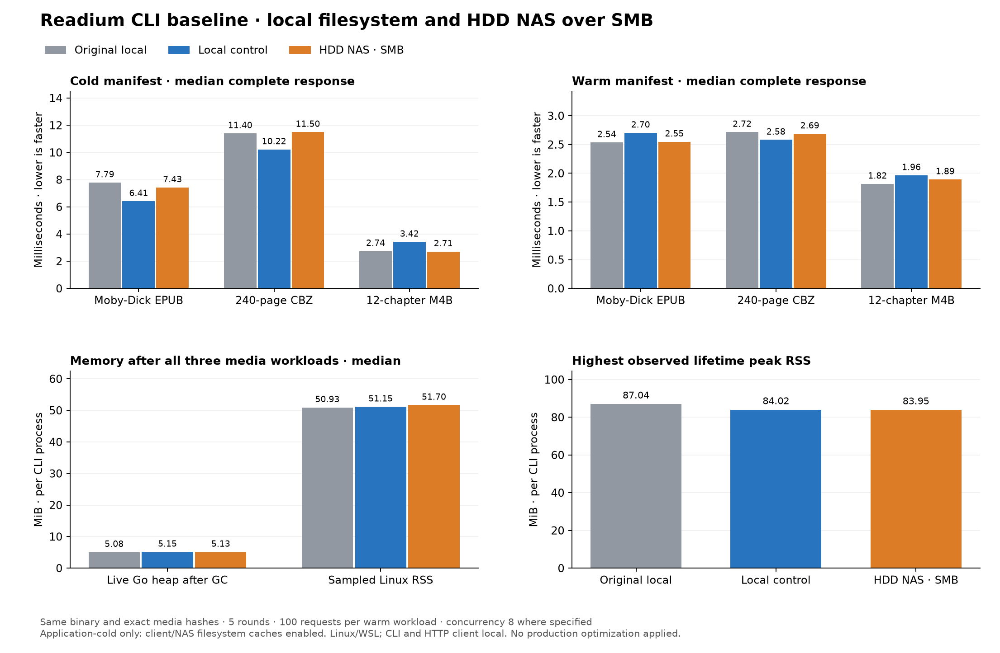

# HDD NAS and local storage baseline — 2026-10-29

The exact original media are now retained under `/mnt/Media/Reader_Testing/`,
in `synthetic/` and `moby-m4b/` subfolders. SHA-256s, publication reading order,
TOC counts, audio duration, workload counts/concurrency, selected-media response lengths, and
HTTP binary SHA-256 match the original baseline. No production serving or cache
behavior has changed.



[Interactive latency comparison](storage-comparison-2026-10-29/storage-comparison.html)
includes both datasets, every workload, first-byte/complete response and p50/p95.

## Setup and interpretation

- NAS is HDD-backed, confirmed by its owner. `/mnt/Media` is mounted using
  Linux CIFS / SMB 3.1.1 with `cache=strict`, `actimeo=1`, `closetimeo=1`,
  and 4 MiB negotiated read/write sizes. Media are served **in place** from
  the NAS, including same-filesystem cache-pressure copies.
- CLI and HTTP client stay on the same Linux/WSL host. Local control uses an
  ext4 virtual disk; its physical host storage type is not inferred from
  the guest's rotational flag. This is local-filesystem versus HDD NAS over
  SMB, not an isolated SSD-versus-HDD or physical disk throughput test.
- Same original binary: CLI `d123c32`, toolkit `c070049`, matching Reader pins.
  Harness `67a84ea` adds in-place library selection and safe owned scratch
  files. Five rounds, 100 requests per warm workload, concurrency eight where
  specified, Go 1.26.0, `GOMAXPROCS=4`, `GOMEMLIMIT` unset, debug mode on.
- Run order: local synthetic HTTP, local Moby-Dick/M4B HTTP, local Go benchmarks
  and profiles, then NAS equivalents. All timed suites run sequentially.
  A matched local rerun distinguishes host/run-to-run drift from NAS effects;
  original results remain unchanged and are shown alongside it. Cache-pressure
  copies use an owned scratch namespace; its longer manifest self URL is the
  sole allowed response-length difference from the original run.
- "Cold" clears only the CLI's publication cache. Copying/hash verification
  and repeated reads can warm client and server filesystem caches. No global
  cache flush, NAS restart or cache-policy change was performed. These are the
  **same application-cold/warm workloads**, not uncached NAS platter reads.
- Memory figures are for the local CLI process, including its retained heap
  and RSS. NAS server RAM and client kernel SMB/page-cache memory are outside
  those process measurements. File transfer latency includes the mounted SMB
  path; HTTP to a remote user and the Reader proxy are still excluded.

## HTTP latency, complete response

Numbers are pooled nearest-rank **p50 / p95 milliseconds** over the same number
of requests per row: cold serial/revisit 5, cold burst 40, warm 500, pressure
opens 60. NAS/local ratios compare medians with the matched local control;
values above one mean higher NAS latency. Cold tails have few samples and
should not be treated as stable production tail estimates. Full assets are
one middle reading-order resource, not the entire publication. Range requests
are `bytes=0-65535`, clamped for shorter resources.

### Synthetic EPUB / CBZ / WAV

| Media | Workload | Original local | Local control | HDD NAS | NAS/local p50 |
| --- | --- | ---: | ---: | ---: | ---: |
| Synthetic EPUB | Cold manifest, serial | 5.017 / 5.899 | 5.157 / 5.372 | 5.639 / 6.245 | 1.09× |
| Synthetic EPUB | Cold manifest, 8-client burst | 11.375 / 13.909 | 11.309 / 14.024 | 12.052 / 15.746 | 1.07× |
| Synthetic EPUB | Warm manifest | 2.239 / 3.453 | 2.007 / 2.854 | 2.295 / 3.426 | 1.14× |
| Synthetic EPUB | Warm manifest, concurrency 8 | 7.976 / 14.859 | 8.275 / 15.588 | 8.022 / 16.341 | 0.97× |
| Synthetic EPUB | Warm full asset | 1.984 / 3.346 | 2.001 / 3.313 | 1.996 / 3.134 | 1.00× |
| Synthetic EPUB | Warm full asset, concurrency 8 | 7.554 / 16.340 | 7.358 / 13.843 | 6.971 / 13.695 | 0.95× |
| Synthetic EPUB | Warm prefix range | 1.925 / 3.303 | 1.974 / 2.996 | 1.965 / 3.105 | 1.00× |
| Synthetic EPUB | Cache-pressure opens | 4.420 / 7.124 | 4.669 / 7.082 | 10.682 / 14.058 | 2.29× |
| Synthetic EPUB | Revisit after cache pressure | 2.863 / 7.071 | 3.130 / 3.565 | 2.557 / 2.877 | 0.82× |
| 240-page CBZ | Cold manifest, serial | 10.754 / 11.156 | 10.344 / 11.478 | 11.527 / 14.517 | 1.11× |
| 240-page CBZ | Cold manifest, 8-client burst | 43.940 / 78.097 | 39.254 / 52.146 | 40.472 / 49.566 | 1.03× |
| 240-page CBZ | Warm manifest | 2.614 / 3.929 | 2.617 / 3.716 | 2.631 / 3.660 | 1.01× |
| 240-page CBZ | Warm manifest, concurrency 8 | 8.667 / 17.069 | 8.894 / 16.967 | 8.217 / 15.739 | 0.92× |
| 240-page CBZ | Warm full asset | 1.782 / 3.110 | 1.959 / 3.101 | 1.806 / 3.036 | 0.92× |
| 240-page CBZ | Warm full asset, concurrency 8 | 7.101 / 14.698 | 8.042 / 15.207 | 7.002 / 12.693 | 0.87× |
| 240-page CBZ | Warm prefix range | 1.884 / 3.541 | 2.048 / 3.156 | 1.816 / 2.868 | 0.89× |
| 240-page CBZ | Cache-pressure opens | 10.055 / 16.242 | 10.188 / 13.325 | 54.909 / 67.956 | 5.39× |
| 240-page CBZ | Revisit after cache pressure | 11.440 / 15.721 | 9.155 / 9.919 | 10.407 / 11.473 | 1.14× |
| 60-second WAV | Cold manifest, serial | 2.161 / 2.342 | 2.501 / 3.271 | 2.560 / 2.867 | 1.02× |
| 60-second WAV | Cold manifest, 8-client burst | 7.002 / 13.651 | 8.997 / 13.493 | 30.277 / 79.722 | 3.37× |
| 60-second WAV | Warm manifest | 1.996 / 3.438 | 1.967 / 3.237 | 1.928 / 3.044 | 0.98× |
| 60-second WAV | Warm manifest, concurrency 8 | 7.542 / 15.850 | 7.542 / 14.254 | 6.968 / 14.261 | 0.92× |
| 60-second WAV | Warm full asset | 2.825 / 4.659 | 2.683 / 3.922 | 2.809 / 4.105 | 1.05× |
| 60-second WAV | Warm full asset, concurrency 8 | 8.502 / 16.692 | 7.599 / 14.008 | 7.792 / 14.234 | 1.03× |
| 60-second WAV | Warm prefix range | 2.124 / 3.772 | 1.958 / 3.332 | 1.917 / 2.920 | 0.98× |
| 60-second WAV | Cache-pressure opens | 2.867 / 4.677 | 2.631 / 3.920 | 21.608 / 31.199 | 8.21× |
| 60-second WAV | Revisit after cache pressure | 2.377 / 3.632 | 2.056 / 2.759 | 20.046 / 28.863 | 9.75× |

First-byte latency is retained in each raw JSON file and the interactive chart.

### Moby-Dick / CBZ / chaptered M4B

| Media | Workload | Original local | Local control | HDD NAS | NAS/local p50 |
| --- | --- | ---: | ---: | ---: | ---: |
| Moby-Dick EPUB | Cold manifest, serial | 7.789 / 9.748 | 6.411 / 7.991 | 7.427 / 7.465 | 1.16× |
| Moby-Dick EPUB | Cold manifest, 8-client burst | 16.503 / 25.710 | 15.577 / 19.311 | 14.662 / 19.780 | 0.94× |
| Moby-Dick EPUB | Warm manifest | 2.537 / 3.583 | 2.703 / 4.097 | 2.548 / 3.484 | 0.94× |
| Moby-Dick EPUB | Warm manifest, concurrency 8 | 8.439 / 15.965 | 10.046 / 19.465 | 8.660 / 16.892 | 0.86× |
| Moby-Dick EPUB | Warm full asset | 1.984 / 3.328 | 1.940 / 3.374 | 2.058 / 3.092 | 1.06× |
| Moby-Dick EPUB | Warm full asset, concurrency 8 | 6.502 / 12.063 | 7.672 / 14.623 | 7.426 / 14.180 | 0.97× |
| Moby-Dick EPUB | Warm prefix range | 1.973 / 3.231 | 2.020 / 3.207 | 1.972 / 3.084 | 0.98× |
| Moby-Dick EPUB | Cache-pressure opens | 5.293 / 6.621 | 6.269 / 8.399 | 12.466 / 16.169 | 1.99× |
| Moby-Dick EPUB | Revisit after cache pressure | 2.772 / 4.242 | 3.217 / 3.472 | 2.843 / 3.724 | 0.88× |
| 240-page CBZ | Cold manifest, serial | 11.400 / 11.861 | 10.218 / 15.525 | 11.499 / 12.661 | 1.13× |
| 240-page CBZ | Cold manifest, 8-client burst | 42.949 / 63.507 | 41.645 / 55.246 | 48.241 / 52.523 | 1.16× |
| 240-page CBZ | Warm manifest | 2.716 / 4.024 | 2.581 / 3.812 | 2.688 / 3.705 | 1.04× |
| 240-page CBZ | Warm manifest, concurrency 8 | 9.030 / 16.563 | 9.098 / 19.109 | 9.010 / 17.204 | 0.99× |
| 240-page CBZ | Warm full asset | 1.886 / 3.373 | 2.021 / 3.929 | 2.079 / 3.131 | 1.03× |
| 240-page CBZ | Warm full asset, concurrency 8 | 6.914 / 13.366 | 7.224 / 14.072 | 7.697 / 14.933 | 1.07× |
| 240-page CBZ | Warm prefix range | 1.685 / 2.918 | 2.136 / 3.662 | 1.974 / 3.083 | 0.92× |
| 240-page CBZ | Cache-pressure opens | 9.715 / 12.773 | 11.227 / 13.209 | 54.398 / 71.051 | 4.85× |
| 240-page CBZ | Revisit after cache pressure | 8.678 / 17.940 | 11.076 / 13.394 | 9.296 / 12.165 | 0.84× |
| 12-chapter M4B | Cold manifest, serial | 2.742 / 3.885 | 3.421 / 3.800 | 2.712 / 3.866 | 0.79× |
| 12-chapter M4B | Cold manifest, 8-client burst | 8.312 / 10.167 | 7.837 / 10.595 | 21.058 / 35.263 | 2.69× |
| 12-chapter M4B | Warm manifest | 1.816 / 2.981 | 1.964 / 3.410 | 1.893 / 3.037 | 0.96× |
| 12-chapter M4B | Warm manifest, concurrency 8 | 6.354 / 12.169 | 7.578 / 14.892 | 6.935 / 13.327 | 0.92× |
| 12-chapter M4B | Warm full asset | 1.868 / 3.128 | 1.848 / 3.126 | 1.855 / 3.046 | 1.00× |
| 12-chapter M4B | Warm full asset, concurrency 8 | 6.338 / 12.059 | 7.507 / 17.802 | 6.754 / 12.285 | 0.90× |
| 12-chapter M4B | Warm prefix range | 1.725 / 2.827 | 2.039 / 3.720 | 1.889 / 3.060 | 0.93× |
| 12-chapter M4B | Cache-pressure opens | 2.480 / 4.031 | 2.908 / 4.476 | 13.409 / 16.695 | 4.61× |
| 12-chapter M4B | Revisit after cache pressure | 2.749 / 3.777 | 2.982 / 4.189 | 11.247 / 11.547 | 3.77× |

First-byte latency is retained in each raw JSON file and the interactive chart.

## Observations

The fresh local control and the NAS have similar warm-request latency for these
cacheable fixtures. Small differences in either direction overlap the observed
run-to-run variation; they do not show that NAS disks are faster than local
storage. The original and rerun local results are both shown for that reason.

Audio first-open contention is more visible: the M4B eight-client cold burst is
21.058 ms median / 35.263 ms p95 on the NAS versus 7.837 / 10.595 ms locally
(2.69× higher median latency). WAV cold bursts are 30.277 / 79.722 ms versus
8.997 / 13.493 ms (3.37×). After cache pressure, audio revisits also show higher
NAS latency, but each such row has only five samples and policy-dependent cache
admission; the data does not isolate a physical disk, SMB metadata or parsing
cause. These are candidates for the next optimization investigation, not a new
claim about uncached HDD throughput.

For Moby-Dick/CBZ/M4B, post-workload median live heap is 5.13 MiB on the NAS
versus 5.15 MiB locally, and process RSS is 51.70 versus 51.15 MiB. Allocation
profiles still attribute approximately 99% of sampled allocated bytes to
compression-adapter construction. The serving code remains unchanged.

Because SMB is mounted as a local filesystem path, the CLI/toolkit exercise
their file/archive paths, including file stat/open/read operations. This does
not exercise the toolkit's HTTP/S3/GCS remote-archive cache configuration.

## Go router/cache benchmarks

Synthetic fixtures, same benchmark configurations as the original. Medians of
five runs; allocation is B/op churn, not retained memory. No media copying or
fixture generation occurs inside measured loops.

| Benchmark | Original local µs / B | Local control µs / B | HDD NAS µs / B |
| --- | ---: | ---: | ---: |
| Serving/book.epub/manifest | 1,702.151 / 6,333,130 | 1,888.339 / 6,336,730 | 1,850.954 / 6,340,483 |
| Serving/book.epub/asset | 1,384.296 / 6,250,904 | 1,591.518 / 6,258,480 | 1,706.343 / 6,259,880 |
| Serving/comic.cbz/manifest | 2,257.304 / 6,376,674 | 2,074.119 / 6,375,951 | 2,060.642 / 6,373,417 |
| Serving/comic.cbz/asset | 1,566.171 / 6,217,994 | 1,488.031 / 6,220,551 | 1,635.587 / 6,219,453 |
| Serving/audio.wav/manifest | 1,322.313 / 6,142,765 | 1,405.560 / 6,143,238 | 1,435.434 / 6,144,449 |
| Serving/audio.wav/asset | 1,196.480 / 6,136,808 | 1,455.242 / 6,138,744 | 1,528.232 / 6,141,158 |
| PublicationCache/book.epub/hit | 2.660 / 840 | 2.818 / 808 | 3.376 / 808 |
| PublicationCache/book.epub/open_close | 1,734.292 / 988,232 | 1,833.899 / 988,527 | 1,877.948 / 988,260 |
| PublicationCache/comic.cbz/hit | 2.640 / 840 | 2.727 / 808 | 3.377 / 808 |
| PublicationCache/comic.cbz/open_close | 6,613.364 / 18,178,785 | 7,320.466 / 18,178,590 | 7,647.468 / 18,178,676 |
| PublicationCache/audio.wav/hit | 2.621 / 840 | 2.748 / 808 | 3.329 / 808 |
| PublicationCache/audio.wav/open_close | 275.157 / 392,828 | 314.074 / 392,525 | 370.267 / 392,527 |

## Process memory

Go heap and RSS are median MiB across five rounds, with GC forced before the
heap snapshot. Rows are cumulative process state, not per-publication cost.
"Peak" is the highest sampled lifetime high-water mark, including cache pressure.


### synthetic

| Phase / metric | Original local | Local control | HDD NAS |
| --- | ---: | ---: | ---: |
| idle_post_gc · Live heap | 3.02 | 3.02 | 3.03 |
| idle_post_gc · Reserved heap | 7.56 | 7.59 | 11.53 |
| idle_post_gc · RSS | 39.62 | 39.25 | 39.50 |
| book.epub_post_gc · Live heap | 4.11 | 4.01 | 4.33 |
| book.epub_post_gc · Reserved heap | 47.41 | 51.28 | 51.38 |
| book.epub_post_gc · RSS | 51.76 | 48.30 | 47.55 |
| comic.cbz_post_gc · Live heap | 4.98 | 4.98 | 5.02 |
| comic.cbz_post_gc · Reserved heap | 51.28 | 55.25 | 55.09 |
| comic.cbz_post_gc · RSS | 50.83 | 50.25 | 50.22 |
| audio.wav_post_gc · Live heap | 4.92 | 4.84 | 4.94 |
| audio.wav_post_gc · Reserved heap | 51.16 | 55.22 | 55.03 |
| audio.wav_post_gc · RSS | 49.47 | 49.94 | 54.09 |
| book.epub_cache_pressure_post_gc · Live heap | 5.02 | 5.02 | 5.04 |
| book.epub_cache_pressure_post_gc · Reserved heap | 51.16 | 55.22 | 55.00 |
| book.epub_cache_pressure_post_gc · RSS | 51.70 | 51.32 | 50.22 |
| comic.cbz_cache_pressure_post_gc · Live heap | 4.97 | 4.97 | 4.99 |
| comic.cbz_cache_pressure_post_gc · Reserved heap | 51.16 | 55.16 | 54.97 |
| comic.cbz_cache_pressure_post_gc · RSS | 52.59 | 51.91 | 52.25 |
| audio.wav_cache_pressure_post_gc · Live heap | 4.82 | 4.82 | 4.85 |
| audio.wav_cache_pressure_post_gc · Reserved heap | 51.16 | 55.16 | 54.94 |
| audio.wav_cache_pressure_post_gc · RSS | 49.92 | 50.21 | 49.57 |
| Peak RSS | 82.22 | 82.89 | 85.16 |

### moby-m4b

| Phase / metric | Original local | Local control | HDD NAS |
| --- | ---: | ---: | ---: |
| idle_post_gc · Live heap | 3.02 | 3.03 | 3.02 |
| idle_post_gc · Reserved heap | 11.53 | 7.56 | 11.56 |
| idle_post_gc · RSS | 39.25 | 39.12 | 39.62 |
| external-0.epub_post_gc · Live heap | 4.57 | 4.65 | 4.51 |
| external-0.epub_post_gc · Reserved heap | 55.22 | 51.34 | 55.16 |
| external-0.epub_post_gc · RSS | 50.20 | 50.91 | 49.71 |
| comic.cbz_post_gc · Live heap | 5.27 | 5.24 | 5.26 |
| comic.cbz_post_gc · Reserved heap | 55.22 | 55.09 | 59.03 |
| comic.cbz_post_gc · RSS | 52.68 | 52.74 | 51.77 |
| external-2.m4b_post_gc · Live heap | 5.08 | 5.15 | 5.13 |
| external-2.m4b_post_gc · Reserved heap | 59.16 | 55.09 | 59.06 |
| external-2.m4b_post_gc · RSS | 50.93 | 51.15 | 51.70 |
| external-0.epub_cache_pressure_post_gc · Live heap | 5.39 | 5.40 | 5.42 |
| external-0.epub_cache_pressure_post_gc · Reserved heap | 59.16 | 55.09 | 59.06 |
| external-0.epub_cache_pressure_post_gc · RSS | 49.38 | 50.96 | 51.75 |
| comic.cbz_cache_pressure_post_gc · Live heap | 5.20 | 5.20 | 5.22 |
| comic.cbz_cache_pressure_post_gc · Reserved heap | 59.16 | 55.00 | 59.00 |
| comic.cbz_cache_pressure_post_gc · RSS | 52.20 | 53.93 | 52.12 |
| external-2.m4b_cache_pressure_post_gc · Live heap | 5.06 | 5.06 | 5.09 |
| external-2.m4b_cache_pressure_post_gc · Reserved heap | 59.16 | 55.00 | 59.00 |
| external-2.m4b_cache_pressure_post_gc · RSS | 49.17 | 51.21 | 51.47 |
| Peak RSS | 87.04 | 84.02 | 83.95 |

## Reproduce and validate

The original [methodology](README.md) remains applicable. In-place mode matters:
`--epub`/`--audio` alone would copy into local temporary storage and would not
measure NAS serving. For synthetic media:

```sh
GOMAXPROCS=4 go run ./tools/servebench --binary /tmp/readium-perf/readium-before --library-dir /mnt/Media/Reader_Testing/synthetic --storage-label 'HDD NAS over SMB 3.1.1' --rounds 5 --requests 100 --concurrency 8 --output nas-synthetic.json
READIUM_BENCH_LIBRARY=/mnt/Media/Reader_Testing/synthetic GOMAXPROCS=4 go test ./pkg/serve -run '^$' -bench '^(BenchmarkServing|BenchmarkPublicationCache)$' -benchmem -count=5 -benchtime=500ms
```

Repeat HTTP with `--library-dir /mnt/Media/Reader_Testing/moby-m4b` and
`--files external-0.epub,comic.cbz,external-2.m4b`. Use the corresponding local
library directories for matched controls. Profile commands from README accept
the same `READIUM_BENCH_LIBRARY` variable. The measured runs used a prebuilt
Go benchmark executable for both storage locations, avoiding builds during
measurement. These paths describe this run; the original HTTP binary must be
rebuilt from the recorded original revisions to reproduce it elsewhere.

Raw artifacts are in [storage-comparison-2026-10-29](storage-comparison-2026-10-29/):
`local-http-{synthetic,moby-m4b}.json`, `nas-http-{synthetic,moby-m4b}.json`,
`{local,nas}-bench.txt`, `{local,nas}-{allocs,cpu}-top.txt`, and profile-run
outputs. `storage-metadata.json` records the mount and run order. The original
baseline artifacts remain unchanged. The NAS folder also retains a
`fixtures.sha256` file so future runs can validate inputs without regenerating
or overwriting them.

Rebuild the charts/report with Python 3 and matplotlib:
`python tools/servebench/compare_storage.py`. This also asserts matching binary,
fixture/publication information and workload structure before comparing results.
Matplotlib is only a reporting dependency; the Go measurement tools need none.

Validation: full CLI tests, targeted race tests for the harness/fixture selector,
and `go vet` passed. Fixture preparation refuses existing directories, in-place
selection rejects traversal/duplicates/missing files, and generated fixture
hashes are locked to the original baseline. Both complete storage suites passed
HTTP length/prefix/duration validation and original-hash checks. Production
sources in Reader, CLI and toolkit remain unchanged.
